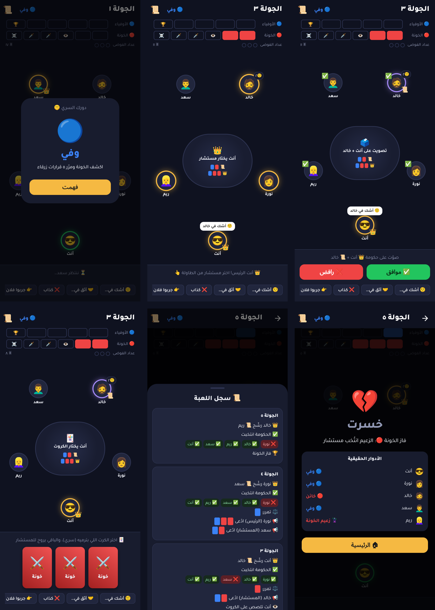

# 🕵️ مجلس الخونة

لعبة جوال أونلاين من نوع **الخداع والأدوار المخفية**. فيها فريقين: **الأوفياء 🔵** و**الخونة 🔴**، وكل التواصل يصير بأزرار وادعاءات وإيموجي، **بدون كتابة ولا صوت**.

النشر الأول على **Google Play**، وبعدها iOS من نفس الكود.



## 📱 جرّبها

**[دليل التجربة على جوالك](docs/how-to-try.md)**: تحميل الـ APK من [Releases](https://github.com/hussainfaisalaljaser-lang/majlis-game/releases)، ورفع السيرفر، واللعب ضد البوتات.

## 📁 هيكل المشروع

| المجلد | وش فيه |
|---|---|
| [`engine/`](engine) | **محرك اللعبة** (TypeScript): القوانين وتوزيع الأدوار والكروت والقدرات. نقي وما يعتمد على أي سيرفر، وبيشتغل داخل Firebase Cloud Functions عشان يمنع الغش |
| [`functions/`](functions) | **السيرفر** (Firebase Cloud Functions): الرومات، والمطابقة، وتطبيق الحركات باستخدام المحرك |
| [`app/`](app) | **تطبيق الجوال** (Flutter): الواجهة بالعربي ومن اليمين لليسار |
| [`firestore.rules`](firestore.rules) | **قواعد الأمان**: الجوال يقرا بس، وكل لاعب يشوف نسخته هو من اللعبة |
| [`docs/`](docs) | [وثيقة التصميم](docs/game-design.md) والتصاميم الأولية |

## 🛠️ التقنيات

- **Flutter**: تطبيق أندرويد (وآيفون لاحقاً) من كود واحد
- **Firebase**: تسجيل الدخول، والرومات اللحظية (Firestore)، ومنطق اللعبة على السيرفر (Cloud Functions)
- **Google Play Billing**: شراء الجواهر والـ VIP

## ▶️ التشغيل

```bash
# المحرك والاختبارات
cd engine && npm install && npm test

# السيرفر: اختبار كامل على محاكي Firebase (يحتاج Java 11+)
cd functions && npm install && npm run build
npx firebase emulators:exec --only auth,firestore,functions "npm run e2e"

# التطبيق على السيرفر الحقيقي
cd app && flutter pub get && flutter run

# التطبيق على المحاكي (محاكي أندرويد يوصل لجهازك عن طريق 10.0.2.2)
cd functions && npm run serve        # في نافذة
cd app && flutter run --dart-define=USE_EMULATOR=true   # في نافذة ثانية
```

## 🚀 رفع السيرفر

Cloud Functions تحتاج خطة **Blaze** في Firebase (الدفع حسب الاستخدام، وفيها كمية مجانية كبيرة كل شهر).

```bash
cd functions && npm install
npx firebase login
npx firebase deploy --only functions,firestore:rules
```

## 🗺️ المراحل

- [x] **المرحلة ١ (الأساس):** محرك القوانين مع الاختبارات، وشاشات الرئيسية واختيار الطاولة والانتظار
- [x] **المرحلة ١ (السيرفر):** ربط Firebase، وروم خاص بكود، والمطابقة العشوائية، وكشف الدور السري
- [x] **المرحلة ١ (الطاولة):** شاشة اللعب الكاملة: الترشيح، والتصويت، والكروت، والادعاءات، والقدرات، والفيتو، والردود السريعة، ومؤشر الشك، والسجل، وشاشة النهاية
- [x] **المرحلة ٢ (الحساب والذهب):** اختيار الاسم والصورة، والملف الشخصي والمستوى، والهدية اليومية، ورسوم الطاولات والجوائز
- [x] **البوتات:** تدريب ضد ٤ بوتات، وإضافة بوتات في الروم الخاص، وتكميل الطاولات العامة بعد ٢٠ ثانية
- [x] **البناء التلقائي:** ملف APK في Releases مع كل حفظ، ورفع السيرفر من GitHub Actions
- [ ] **النشر:** ترقية Blaze وإضافة مفتاح الرفع ([الدليل](docs/how-to-try.md))
- [x] **المرحلة ٢ (تكملة):** مؤقت الأدوار (السيرفر يلعب بدال اللي يتأخر)، والمهام اليومية، وجدول الترتيب الأسبوعي والكلي
- [x] **المرحلة ٣:** المتجر (إطارات وأشكال كروت بالذهب أو الجواهر)، والإشعارات لما يجي دورك، والأيقونة وشاشة البداية
- [ ] **المرحلة ٣ (تكملة):** شراء الجواهر بفلوس حقيقية (Google Play Billing)، والـ VIP
- [ ] **المرحلة ٤:** الاختبار المغلق والنشر على Google Play
