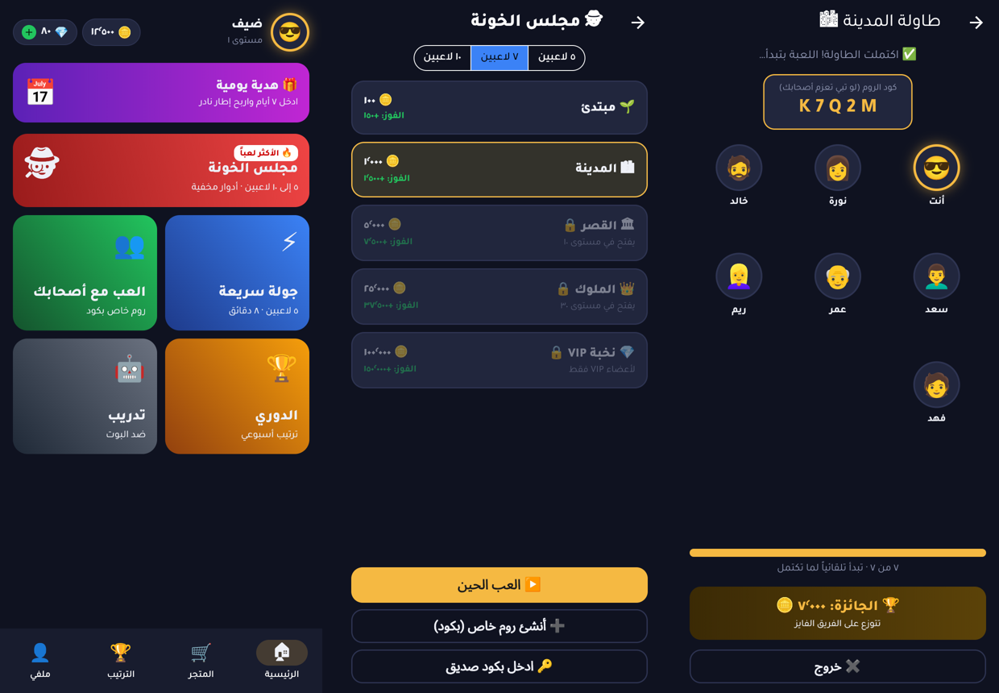

# 🕵️ مجلس الخونة

لعبة جوال أونلاين من نوع **الخداع والأدوار المخفية**. فيها فريقين: **الأوفياء 🔵** و**الخونة 🔴**، وكل التواصل يصير بأزرار وادعاءات وإيموجي، **بدون كتابة ولا صوت**.

النشر الأول على **Google Play**، وبعدها iOS من نفس الكود.



## 📁 هيكل المشروع

| المجلد | وش فيه |
|---|---|
| [`engine/`](engine) | **محرك اللعبة** (TypeScript): القوانين وتوزيع الأدوار والكروت والقدرات. نقي وما يعتمد على أي سيرفر، وبيشتغل داخل Firebase Cloud Functions عشان يمنع الغش |
| [`app/`](app) | **تطبيق الجوال** (Flutter): الواجهة بالعربي ومن اليمين لليسار |
| [`docs/`](docs) | [وثيقة التصميم](docs/game-design.md) والتصاميم الأولية |

## 🛠️ التقنيات

- **Flutter**: تطبيق أندرويد (وآيفون لاحقاً) من كود واحد
- **Firebase**: تسجيل الدخول، والرومات اللحظية (Firestore)، ومنطق اللعبة على السيرفر (Cloud Functions)
- **Google Play Billing**: شراء الجواهر والـ VIP

## ▶️ التشغيل

```bash
# المحرك والاختبارات
cd engine && npm install && npm test

# التطبيق (يحتاج Flutter)
cd app && flutter pub get && flutter run
```

## 🗺️ المراحل

- [x] **المرحلة ١ (الأساس):** محرك القوانين مع الاختبارات، وشاشات الرئيسية واختيار الطاولة والانتظار
- [ ] **المرحلة ١ (تكملة):** شاشة اللعب، وربط Firebase، وروم بكود، ولعب كامل مع الأصحاب
- [ ] **المرحلة ٢:** المطابقة العشوائية، والذهب، والمهام اليومية
- [ ] **المرحلة ٣:** المتجر، والإطارات، وأشكال البطاقات، والـ VIP
- [ ] **المرحلة ٤:** الاختبار المغلق والنشر على Google Play
